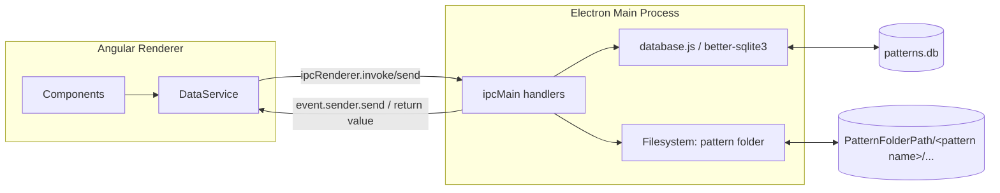

# Architecture

Stitch is an Electron desktop app with an Angular front end, backed by a local SQLite database and a pattern folder on disk. It is a personal pattern library: each pattern record in the database corresponds to a subfolder of files on the user's filesystem.

## 1. Key Modules

| Module | Path | Responsibility |
|---|---|---|
| Electron main process | [main.js](main.js) | App/window lifecycle, config/settings loading, filesystem operations (create/copy/delete pattern folders and files), all `ipcMain` handlers |
| Preload script | [preload.js](preload.js) | Bridges renderer and main process by exposing `ipcRenderer` and `webUtils.getFilePath` on `window` |
| Angular app | [src/app](src/app) | UI: pattern list/grid, pattern details, add/edit pattern forms, settings |
| `DataService` | [src/app/services/data.service.ts](src/app/services/data.service.ts) | Single point of contact between Angular components and the main process; exposes pattern data as an RxJS `BehaviorSubject` |
| `ModalsService` | [src/app/services/modals.service.ts](src/app/services/modals.service.ts) | Shared modal/dialog state (currently minimal) |
| `database.js` | [database/database.js](database/database.js) | `better-sqlite3` schema definition and all CRUD queries (patterns, fabrics, materials, photos, tech drawings, files, comments) |
| Migrations | [database/migrations](database/migrations) | Versioned schema changes, run via `npm run db:migrate` ([database/migration.js](database/migration.js)) |
| Shared types | [src/app/classes.ts](src/app/classes.ts) | `Pattern`, `PatternEdit`, `Category`, etc. — the contract between Angular and the IPC payloads |
| `config.json` | [config.json](config.json) | Stores the configured pattern folder path, read by `main.js` on startup |

## 2. Data Flow

There is no network layer — all data flows between the Angular renderer and the Electron main process over Electron's IPC (`ipcRenderer`/`ipcMain`), since `nodeIntegration` is enabled and `contextIsolation` is disabled.

Two IPC styles are used:
- **Request/response** (`ipcRenderer.invoke` + `ipcMain.handle`): reading data, e.g. `patterns:getAll`, `patterns:getDetails`, `comments:add/edit/delete`.
- **Fire-and-forget with broadcast** (`ipcRenderer.send` + `ipcMain.on`): mutating operations that touch both the filesystem and the database, e.g. `patterns:addNew`, `patterns:edit`, `patterns:delete`. These handlers perform the file operations, update SQLite, then push the full refreshed pattern list back to the renderer via `event.sender.send('patterns:update', patterns)`, which `DataService` listens for and republishes through `patternList$`.

Typical "add pattern" flow:
1. Component builds a `Pattern`/`NewPattern` object (including absolute source file paths from the OS file picker, resolved via `window.getFilePath`).
2. `DataService.addPattern()` sends it over `patterns:addNew`.
3. `main.js` creates `<patternFolderPath>/<pattern name>/` (+ a `pictures` subfolder), copies the selected files into it, then calls `db.addPattern(...)`.
4. `main.js` re-reads all patterns and broadcasts `patterns:update`.
5. `DataService` updates `_patternList`, and subscribed components re-render.

Edit/delete follow the same copy-to-disk-then-update-database-then-broadcast pattern.

## 3. External Services / Libraries

Stitch has no remote/cloud backend. "External" here means off-process or third-party dependencies:
- **Electron** — desktop shell, windowing, IPC, native file dialogs via `shell`.
- **better-sqlite3** — synchronous local SQLite access from the main process (the app's only database).
- **sqlite3** — used by the migration scripts in `/database` (separate from the runtime driver).
- **electron-settings** — persists app settings (e.g. pattern folder path) outside of `config.json`.
- **Local filesystem** — the pattern folder (path from `config.json` / `PATTERN_FOLDER_PATH` env var) is the source of truth for pattern files (originals, pictures, tech drawings); SQLite stores metadata and relative/absolute paths pointing into it.
- **Angular Material / Bootstrap / MDB / Font Awesome** — UI component and icon libraries, no runtime services.

## 4. Design Decisions

This section will be filled in collaboratively as the project evolves, capturing the *why* behind notable choices (e.g. why IPC instead of a REST layer, why `nodeIntegration`/`contextIsolation` are configured this way, why SQLite + filesystem instead of embedding files in the DB, etc.).

- _(placeholder — to be completed together)_
