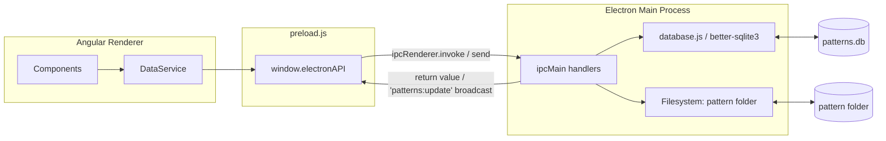

# Architecture

Stitch is an Electron desktop app with an Angular front end, backed by a local SQLite database and a pattern folder on disk. It is a personal pattern library: each pattern record in the database corresponds to a subfolder of files on the user's filesystem.

## 1. Key Modules

| Module | Path | Responsibility |
|---|---|---|
| Electron main process | [main.js](main.js) | App/window lifecycle, filesystem operations (create/copy/delete pattern folders and files), all `ipcMain` handlers |
| Preload script | [preload.js](preload.js) | The only bridge between the Angular app and the main process: exposes a typed `window.electronAPI` object through `contextBridge` (see section 2) |
| Angular app | [src/app](src/app) | UI: pattern list, pattern details / add / edit pages, settings |
| Routes | [src/app/app.config.ts](src/app/app.config.ts) | Angular routes (see section 3) |
| `DataService` | [src/app/services/data.service.ts](src/app/services/data.service.ts) | Single point of contact between Angular components and `window.electronAPI`; exposes the pattern list as an RxJS `BehaviorSubject` (`patternList$`) |
| `PatternFiltersService` | [src/app/services/pattern-filters.service.ts](src/app/services/pattern-filters.service.ts) | Holds the pattern list's search text, selected categories and preview source, so they survive navigation |
| `ConfirmDialogService` + `ConfirmDialogComponent` | [src/app/services/confirm-dialog.service.ts](src/app/services/confirm-dialog.service.ts), [src/app/confirm-dialog](src/app/confirm-dialog) | The app's single confirmation modal: `await confirm(title, message, confirmLabel, danger)` returns `true`/`false` |
| `unsavedChangesGuard` | [src/app/guards/unsaved-changes.guard.ts](src/app/guards/unsaved-changes.guard.ts) | Asks for confirmation before leaving the add/edit pages with unsaved changes |
| `CategoryPickerComponent` | [src/app/category-picker](src/app/category-picker) | Category selection of the add/edit forms (dropdown with search + checkboxes, selection as chips, 1 to 5 categories): `[(selectedIds)]="pattern.categoryIds"` |
| `AppTitleStrategy` | [src/app/app-title.strategy.ts](src/app/app-title.strategy.ts) | Sets the window title from the route's `title` ("Patterns – Stitch") |
| Format helpers | [src/app/utils/pattern-format.ts](src/app/utils/pattern-format.ts) | `fileName(path)` and `categoryNames(ids, categories)`, shared by the pattern pages |
| Electron API types | [src/types/index.d.ts](src/types/index.d.ts) | TypeScript declaration of `window.electronAPI` |
| Shared types | [src/app/classes.ts](src/app/classes.ts) | `Pattern`, `NewPattern`, `Category`, `SharedFile`, etc. — the contract between Angular and the IPC payloads |
| `database.js` | [database/database.js](database/database.js) | `better-sqlite3` schema definition and all CRUD queries (patterns, categories, fabrics, materials, photos, tech drawings, files, shared files, comments) |
| Migrations | [database/migrations](database/migrations) | Versioned schema changes, run via `npm run db:migrate` ([database/migration.js](database/migration.js)) |
| Global styles | [src/styles.scss](src/styles.scss) | Design tokens (colors, spacing, radii) and shared classes: buttons (`primary-button`, `secondary-button`, `subtle-warning-button`, with a shared disabled state), pages (`page`, `page-content`, `page-topbar`, `page-card`), boxes (`light-box`, `grey-box`), forms, filters, modals. Component `.scss` files only hold page-specific details |

## 2. Data Flow

There is no network layer — all data flows between the Angular renderer and the Electron main process over Electron's IPC.

The window runs with `nodeIntegration: false` and `contextIsolation: true`: the Angular app has no access to Node or to `ipcRenderer`. The preload script exposes a fixed list of functions as `window.electronAPI` (one per IPC channel, plus two helpers), and `DataService` is the only Angular code that calls them.



`electronAPI` helpers that don't map to a database operation:
- `getFilePath(file)` — absolute path of a file chosen in a file input or dropped on the page (`webUtils.getPathForFile`, only callable from the preload).
- `openFile(path)` — opens a file with the OS default app (`shell.openPath` in the main process, falls back to showing it in the folder).

Two IPC styles are used:
- **Request/response** (`ipcRenderer.invoke` + `ipcMain.handle`): reads (`patterns:getAll`, `patterns:getDetails`, `sharedFiles:getAll`, categories), comments, and the pattern mutations whose result the page waits for:
  - `patterns:addNew` returns the new pattern's id (or `null` if the database insert fails), so the app can open its details page.
  - `patterns:edit` resolves once files are copied and the database is updated.
- **Fire-and-forget** (`ipcRenderer.send` + `ipcMain.on`): `patterns:delete` and `patterns:openFile`.

After any pattern mutation (add, edit, delete, category delete), the main process re-reads all patterns and broadcasts them with `event.sender.send('patterns:update', patterns)`; `DataService` republishes them through `patternList$`, and the pattern list re-renders.

### Pattern folder layout
```
<pattern folder>/
├── <pattern name>/
│   ├── <pattern files>        (PDFs, etc.)
│   ├── pictures/              (photos)
│   └── techDrawings/          (technical drawings)
└── shared/                    (files shared between several patterns)
```
The database stores the absolute paths of the copied files.

The pattern folder path comes from the `PATTERN_FOLDER_PATH` environment variable (loaded from `.env` by `dotenv`), with a hard-coded fallback in `main.js`. Note: `main.js` also contains `loadConfig()` / `updateConfig()` for `config.json` and `electron-settings`, but `loadConfig()` is currently not called, so `config.json` is not read at startup.

### Typical "add pattern" flow
1. On `/patterns/new`, `AddPatternComponent` builds a `NewPattern` (with absolute source paths from `electronAPI.getFilePath`).
2. `DataService.addPattern()` calls `electronAPI.addPattern()` → `invoke('patterns:addNew')`.
3. `main.js` creates `<pattern folder>/<pattern name>/` with its `pictures/` and `techDrawings/` subfolders, copies the files (new shared files go to `shared/`), then calls `db.addPattern(...)`.
4. `main.js` broadcasts `patterns:update` and returns the new id.
5. The page navigates to `/patterns/<id>`. If adding failed (`null`, or a file copy error caught by `DataService`), it stays on the form so nothing is lost.

Edit follows the same copy-to-disk-then-update-database-then-broadcast pattern, comparing the old and new pattern to know which files to copy or delete. Delete removes the pattern's folder and its database record.

## 3. Pages and Navigation

| Route | Component | Window title | Notes |
|---|---|---|---|
| `/patterns` | `PatternsComponent` | Patterns | List with search (name or brand), multi-category filter (OR logic) and photo/tech drawing preview switch; filters are stored in `PatternFiltersService` |
| `/patterns/new` | `AddPatternComponent` | New pattern | Opens the new pattern's details after saving. Guarded by `unsavedChangesGuard` |
| `/patterns/:patternId` | `PatternDetailsComponent` | *pattern name* | Carousel, metadata, files, comments (deleting a comment asks for confirmation) |
| `/patterns/:patternId/edit` | `PatternEditComponent` | Edit pattern | Save → details page, delete (with confirmation) → list. Guarded by `unsavedChangesGuard` |
| `/settings` | `SettingsComponent` | Settings | Categories (add, rename, delete) |

- `patterns/new` is declared before `patterns/:patternId`, otherwise "new" would be read as a pattern id.
- Route parameters are passed directly to component inputs with the same name (`withComponentInputBinding()`), e.g. `:patternId` → `@Input({ transform: numberAttribute }) patternId` (route params are strings; `numberAttribute` converts them).
- `unsavedChangesGuard` works with any component that has a `hasUnsavedChanges()` method. Add/edit compare the form with a JSON snapshot taken when the form is ready, and skip the check after a successful save or delete.
- **Window titles**: each route has a `title`; `AppTitleStrategy` turns it into "<title> – Stitch" (shown by Electron in the title bar and taskbar, announced by screen readers on navigation). The details page replaces it with "<pattern name> – Stitch" once the pattern has loaded.
- **Focus**: once a pattern's details have loaded, the focus moves to its `<h1>` (`tabindex="-1"`), so screen readers announce which pattern opened and the next Tab continues in the page. "Go to comments" and deleting a comment move the focus to the Comments heading.
- Bootstrap's JavaScript is loaded once in [src/main.ts](src/main.ts) (`import 'bootstrap'`) and is used for the category dropdowns (list filter and category picker) and the confirmation modal.

## 4. External Services / Libraries

Stitch has no remote/cloud backend. "External" here means off-process or third-party dependencies:
- **Electron** — desktop shell, windowing, IPC, opening files with the OS (`shell`).
- **better-sqlite3** — synchronous local SQLite access from the main process (the app's only database).
- **sqlite3** — used by the migration scripts in `/database` (separate from the runtime driver).
- **electron-settings** — settings storage, used by `loadConfig()` / `updateConfig()` in `main.js` (currently not called at startup).
- **Local filesystem** — the pattern folder is the source of truth for pattern files; SQLite stores metadata and the absolute paths pointing into it.
- **Angular Material / Bootstrap (+ Bootswatch) / MDB / Font Awesome / Bootstrap Icons** — UI components and icons, no runtime services.

## 5. Design Decisions

The *why* behind notable choices. To be completed together as the project evolves (e.g. why IPC instead of a REST layer, why SQLite + filesystem instead of embedding files in the DB).

- **Context isolation + preload API** — The window runs with `contextIsolation: true` and `nodeIntegration: false`; the Angular app only sees the functions listed in `window.electronAPI`. This limits what any code in the renderer can do to the explicit list of operations the app needs.
- **Pages instead of modals for details, add and edit** — These screens hold a lot of content (photos, files, comments, long forms with drag-and-drop) that didn't fit an 800px modal, a long form in a modal was easy to lose with Escape or a backdrop click, and the modals required manual DOM handling (moving them to `<body>`, cleaning them up, chaining them). Routed pages solved all three. Modals are kept only for short confirmations.
- **Filters in a root service** — With routed pages, the list component is destroyed when opening a pattern; keeping the search and categories in `PatternFiltersService` means coming back to the list restores them. They are kept in memory only (reset when the app restarts).
- **One reusable confirmation dialog** — Delete confirmation and the unsaved-changes warning share `ConfirmDialogService` instead of the browser's `confirm()`, so they match the app's look; any future confirmation only needs one `await confirm(...)` call.
- **Delete is on the left of the edit form's actions** — Separated from cancel/save so the destructive action isn't clicked by mistake, and it always asks for confirmation.
- **White cards on the grey background** — Pages (details, add, edit, settings) put their content in `page-card`s, the same visual language as the pattern cards of the list. Elements designed for a white background (grey boxes, grey inputs, light outlines) stay visible.
- **One category picker for add and edit** — The category selection is a shared component reusing the list page's filter dropdown, so both forms behave the same and the rules (1 to 5 categories) are shown in the UI instead of silently refusing a click.
- **Button labels in sentence case** — "Save", "Cancel", "Delete pattern"... on every page.
