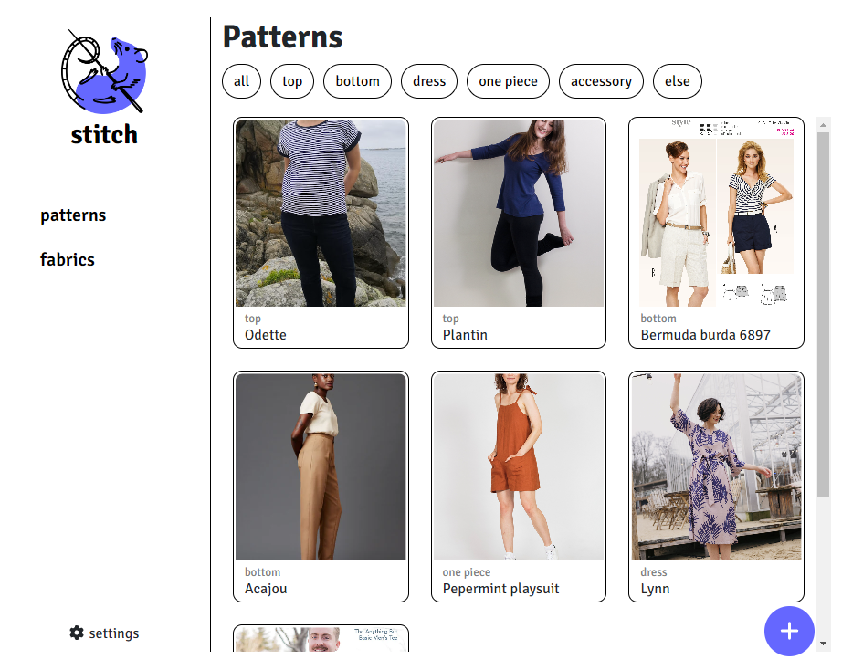
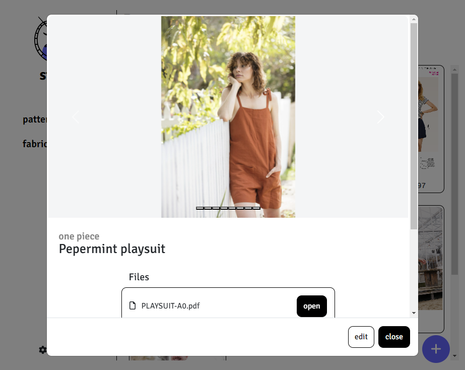
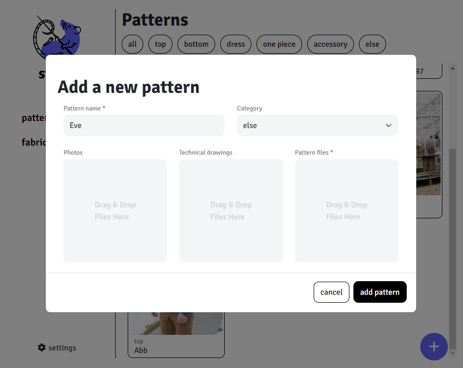
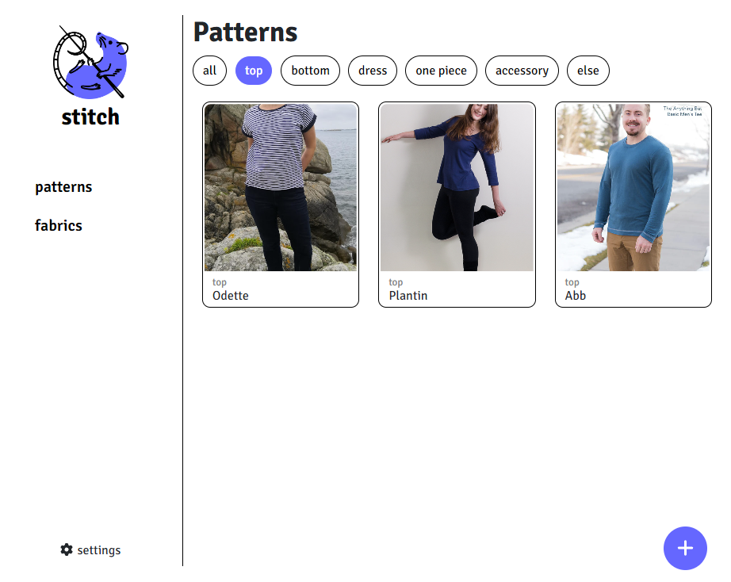

# Stitch

Stitch is a Windows desktop app for organizing a personal collection of sewing patterns. It keeps pattern details, reference images, and pattern files together in a local library that can be filtered by category.

Built with Angular, Electron, and SQLite.

## Features

- Add, view, edit, and delete sewing patterns.
- Organize patterns by category and filter the list by category.
- Browse pattern cards using either photos or technical drawings.
- Store details for each pattern, including its brand, difficulty, whether it is free or paid, and a description.
- Keep a list of required fabrics and materials for each pattern.
- Add, edit, and delete comments on a pattern to keep personal notes.
- Copy pattern documents and images into a centralized local library folder, organized into a folder for each pattern.
- Store the pattern collection in a local SQLite database.

## Screenshots

### Pattern library



### Pattern details



### Add a pattern



### Filter by category



More screenshots are available in the [`screens`](screens) folder.

## Requirements

- Windows
- Node.js and npm
- Git

## Getting started

1. Clone the repository and enter the project directory:

   ```bash
   git clone https://gitlab.com/lou.bt5/stitch.git
   cd stitch
   ```

2. Install the dependencies:

   ```bash
   npm install
   ```

3. Create the folder where Stitch should keep its library. Then create a `.env` file in the project root and set `PATTERN_FOLDER_PATH` to that folder's absolute path. For example:

   ```dotenv
   PATTERN_FOLDER_PATH=C:/Users/YourName/Documents/StitchPatterns
   ```

   The folder must already exist and be writable. `.env` is ignored by Git, so your local path will not be committed.

4. Start Stitch in development mode:

   ```bash
   npm run electron:dev
   ```

To build the Angular app and launch the Electron app, run:

```bash
npm run electron
```

## Development commands

| Command | Description |
| --- | --- |
| `npm run start` | Serve the Angular app in a browser for development. |
| `npm run build` | Build the Angular app. |
| `npm test` | Run the Angular unit tests. |
| `npm run db:migrate` | Run database migrations. |

## Roadmap

- Complete the Settings and Fabrics pages.
- Add a simple favorites feature.
- Support exporting and importing pattern collections to share them with other Stitch users.
- Add an inventory of fabrics available at home.

## License

[MIT](https://choosealicense.com/licenses/mit/)
